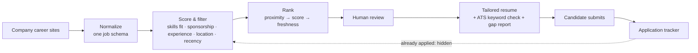

# Job Search Copilot

**A personal decision engine that turns thousands of daily job postings into a short list of roles I can actually win, then helps me apply to each one with an honestly tailored resume.**

---

## The problem

Job searching is a data problem. The hard part isn't writing applications. It's working out which of thousands of postings deserve one, made harder by two things:

- **Hidden "no sponsorship" clauses.** Many postings rule out candidates who need visa sponsorship, but say so in fine print deep in the description, or only on the application form. Candidates find out after they've put in the effort.
- **Inflated experience requirements.** Plenty of "entry-level" or "associate" roles ask for more years of experience than the title suggests, and the number is often buried in a range like "3–5 years."

## Who it's for

Early-career professionals, and especially **international students who need sponsorship-friendly roles**. These candidates can't afford to spend limited application time on postings that were never open to them.

## Product decisions and trade-offs

| Decision | Why | Trade-off accepted |
|---|---|---|
| **Filter first, don't apply everywhere** | Fewer, better-fit applications beat volume. The tool's main job is to remove options. | Some borderline roles get hidden. A toggle can bring them back. |
| **"High-chance" mode** | Shows a role only if it has no sponsorship blocker, asks for experience within my range, isn't a people-manager title, and has strong overlap with my skills. | Conservative by design: when a posting gives several experience numbers, it uses the strictest one. |
| **Human stays in the loop** | The tool finds, scores and drafts. I review every application, and all consents and legal attestations are mine to give. | Slower than full automation, but every application is accurate and intentional. |
| **Honest tailoring only** | The resume tailor rearranges and rewords only facts already on my CV. Skills I don't have are reported as gaps and never added. | Match scores can come out lower, but nothing is fabricated. |
| **Daily cadence** | New postings get attention while they're fresh. Results are cached so repeat views don't trigger new fetches. | Results aren't real-time. They're as fresh as the latest daily run. |
| **Respect source limits** | Requests run with a small, fixed level of concurrency and timeouts, and only public career pages are read. | A full scan takes a little longer. |
| **Local, no AI generation** | Rule-based scoring is transparent and explainable. I can see why a job scored the way it did. | Scoring is less nuanced than a language model's. |

## Key features

- **Multi-source aggregation** across company career sites, normalized into one schema (title, company, location, posting date, description).
- **Fit scoring** against a weighted skills profile, with the matched keywords shown so every score can be explained.
- **Sponsorship detection** that flags phrasing like "unable to sponsor" or "without current or future sponsorship," plus a list of companies known to state it only on the application form.
- **Experience parsing** that pulls out years-required, including spelled-out numbers and ranges.
- **Location ranking**: commutable first, then remote, then in-state, then the rest of the US. Non-US roles are filtered out.
- **Internship mode** with its own rules for co-ops and internships.
- **Tailored resume generator** that produces a role-specific resume, an ATS keyword-match percentage compared with the generic version, an independent second check, and a list of gaps.
- **Application tracker** with a pipeline view: Applied → Assessment → Interviewing → Offer, plus Rejected, No response and Withdrawn.

## How it works

## Results

- **140+ company career sites** monitored from one dashboard.
- **~14,000+ postings scanned per daily run**, cut down to a short list I can review in a few minutes.

## What's next

- Let users configure their own profile so other students can use the tool without editing code.
- Track the outcome of each application to tune the scoring weights against real response rates.
- Add a weekly digest of new high-chance roles instead of a dashboard I have to open.

## About me

**Cheran Seripally**: Product strategy & development | MS ITM @ UT Dallas
[linkedin.com/in/cheran-seripally](https://linkedin.com/in/cheran-seripally)

I build tools that treat messy, everyday problems as product problems: define the user, pick what to optimize for, and make the trade-offs visible.

---

© 2026 Cheran Seripally. All rights reserved. Source code is private; available to recruiters on request.
